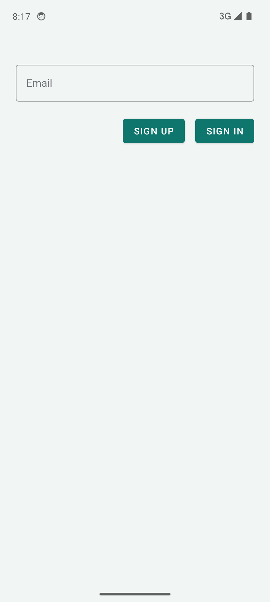
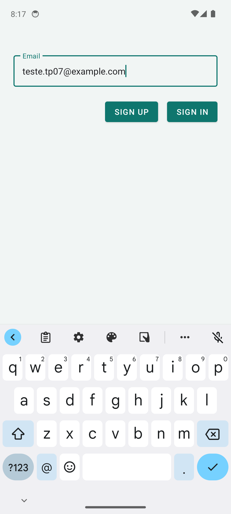
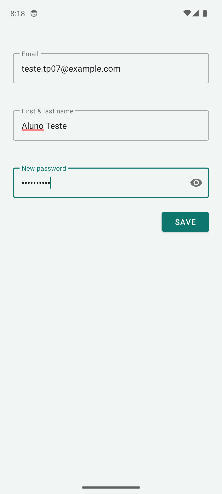
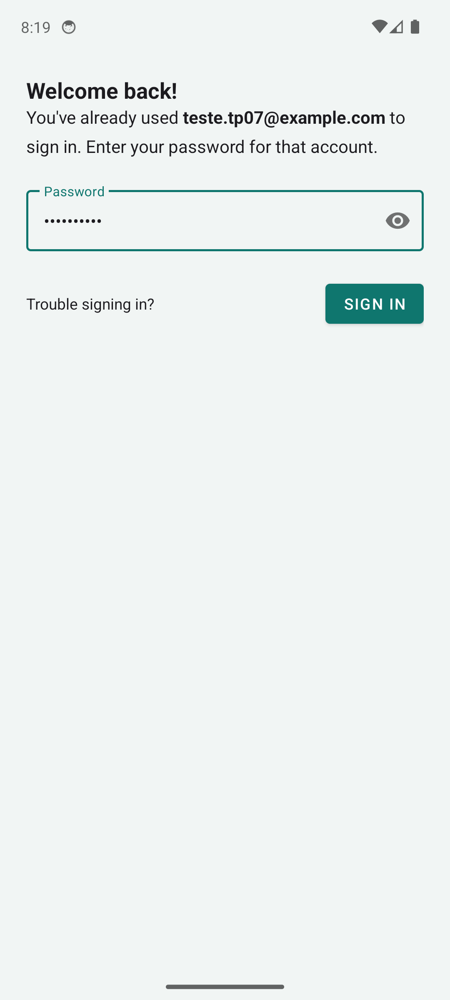
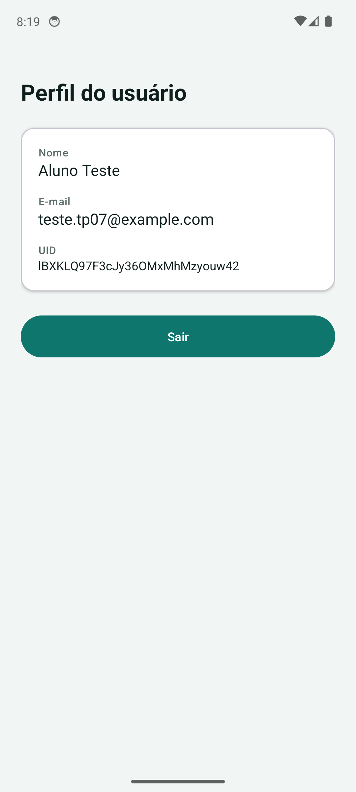

# AppAuthFirebase: Login e cadastro com FirebaseUI

**Participantes:**

- Yasmin dos Santos Batista - RA: 241959
- Victoria Antunes - RA: 239588

**Disciplina:** Desenvolvimento para Dispositivos Móveis
**Professor(a):** ALESSANDRO FERREIRA PAZ DE LIMA

## Sobre o projeto

Aplicativo Android em Kotlin com autenticação via Firebase Authentication, usando a tela pronta do
[FirebaseUI](https://firebase.google.com/docs/auth/android/firebaseui?hl=pt-br).

- **Login** com e-mail e senha (tela do FirebaseUI).
- **Cadastro** de novos usuários pelo mesmo fluxo (opção de criar conta na tela de e-mail).
- **Perfil**: após entrar, mostra nome, e-mail e UID do usuário.
- **Sair**: botão que encerra a sessão e volta para a tela de login.

## Tecnologias

- Kotlin
- Firebase Authentication + FirebaseUI Auth 9.1.1
- Material 3 e ViewBinding

## Prints

| Login                              | E-mail informado                    | Cadastro                                 |
| ---------------------------------- | ----------------------------------- | ---------------------------------------- |
|  |  |  |

| Login com senha                                    | Perfil e botão Sair                  |
| -------------------------------------------------- | ------------------------------------ |
|  |  |

## Como rodar

1. Crie um projeto no [Console do Firebase](https://console.firebase.google.com) e adicione um app Android
   com o pacote `com.example.tp07_authfirebase`.
2. Em **Authentication > Sign-in method**, ative o provedor **E-mail/senha**.
3. Baixe o `google-services.json` e coloque em `app/google-services.json`
   (o arquivo está no `.gitignore`; há um modelo em `app/google-services.json.example`).
4. Abra no Android Studio e execute.

O emulador precisa ter **Google Play Services** (imagem "Google APIs" ou "Google Play"); em imagens
sem ele o FirebaseUI não abre.

## Estrutura

- `view/LoginActivity.kt`: abre o FirebaseUI e trata o resultado.
- `view/MainActivity.kt`: perfil do usuário e botão de sair.
